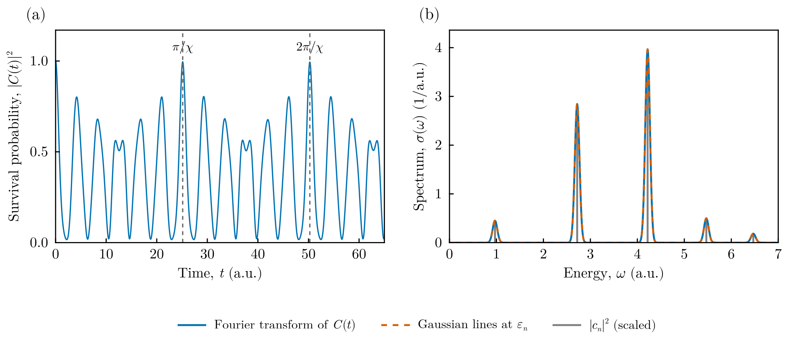

# Autocorrelation function and spectrum of a wave packet

This tutorial shows how the eigenpairs computed by FEMTISE give the time evolution
of a wave packet, its **autocorrelation function** and, by Fourier transform, its
**spectrum**. Both are directly related to measurable quantities: the
autocorrelation function governs pump–probe signals and the spectrum gives the
intensities of absorption or photoelectron bands (Franck–Condon factors).

## 1. Theory

A wave packet $\psi_0$ is expanded in the eigenfunctions $\phi_n$ of the
Hamiltonian, $\hat H\phi_n = \varepsilon_n\phi_n$:

```math
\psi_0 = \sum_n c_n\,\phi_n,\qquad c_n = \langle\phi_n|\psi_0\rangle
= \int \phi_n^*(x)\,\psi_0(x)\,dx .
```

Each component evolves with its own phase, $\psi(t) = \sum_n c_n e^{-i\varepsilon_n t}\phi_n$
(atomic units, $\hbar = 1$). The overlap of the evolved packet with the initial one
is the autocorrelation function

```math
C(t) = \langle\psi_0|\psi(t)\rangle = \sum_n |c_n|^2\, e^{-i\varepsilon_n t},
```

and $|C(t)|^2$ is the survival probability. Its Fourier transform is the spectrum

```math
\sigma(\omega) = \frac{1}{2\pi}\int_{-\infty}^{\infty} C(t)\,e^{i\omega t}\,dt
= \sum_n |c_n|^2\,\delta(\omega-\varepsilon_n):
```

lines at the eigenvalues with intensities $|c_n|^2$. In practice $C(t)$ is known up
to a finite time $T$, so it is multiplied by a window $w(t)$ before the transform,

```math
\sigma(\omega) \approx \frac{1}{\pi}\,\mathrm{Re}\int_0^{T} C(t)\,w(t)\,e^{i\omega t}\,dt ,
```

which replaces each $\delta$ line by a Lorentzian, $w = e^{-\gamma t}$, or a Gaussian,
$w = e^{-\gamma^2t^2/2}$, of width $\gamma$. FEMTISE provides one function per step:

| Step | Function |
|---|---|
| $c_n = \langle\phi_n\vert\psi_0\rangle$ | `expansion_coefficients(ψ₀, states, dΩ)` |
| $C(t)$ | `autocorrelation(c, energies, t)` |
| $\sigma(\omega)$ from the sampled $C(t)$ | `fourier_transform(t, C, ω; window, width)` |
| $\sigma(\omega)$ directly from the lines | `autocorrelation_spectrum(c, energies, ω; width, lineshape)` |

The last two must agree; the comparison is a useful check of the time step and of
the total time $T$.

## 2. The system

A Gaussian packet released in the Morse potential (mass 1, atomic units)

```math
V(x) = D\left[1-e^{-ax}\right]^2,\qquad D = 8,\quad a = 0.5,
```

whose bound levels are $\varepsilon_n = \omega(n+\frac12)-\chi(n+\frac12)^2$ with
$\omega = a\sqrt{2D} = 2$ and $\chi = \omega^2/4D = 0.125$. The initial packet is
the ground state of the harmonic approximation displaced by $x_0 = 2$:

```math
\psi_0(x) = \left(\frac{\omega}{\pi}\right)^{1/4} e^{-\omega(x-x_0)^2/2}.
```

All files are in `src/autocorrelation_spectrum/` of the
[FEMTISE_TUTORIAL](https://github.com/mendzmartin/FEMTISE_TUTORIAL) repository.

## 3. The calculation

The tutorial uses the low-level interface; no input file is needed:

```julia
using FEMTISE, Gridap

D, a = 8.0, 0.5
morse(x) = D * (1 - exp(-a * x[1]))^2
model = CartesianDiscreteModel((-4.0, 20.0), (1200,))
sol = solve_tise(model, morse; nev = 30, sigma = 0.0)      # 30 lowest eigenpairs

ω = a * sqrt(2D)
ψ₀(x) = (ω / π)^0.25 * exp(-ω * (x[1] - 2.0)^2 / 2)
c = expansion_coefficients(ψ₀, sol.states, sol.dΩ)        # cₙ = ⟨φₙ|ψ₀⟩

t = collect(0.0:0.02:300.0)
C = autocorrelation(c, sol.energies, t)                    # C(t)

E = collect(range(0.0, 7.0, length = 3501))
σ_from_C = fourier_transform(t, C, E; window = :gaussian, width = 0.05)
σ_direct = autocorrelation_spectrum(c, sol.energies, E; width = 0.05, lineshape = :gaussian)
```

The time step $\Delta t = 0.02$ resolves energies up to $\pi/\Delta t \approx 157$
hartree, far above the levels populated by the packet, and the Gaussian window of
width $\gamma = 0.05$ has decayed completely at $T = 300$.

Run it with

```bash
julia --project=. src/autocorrelation_spectrum/run_tutorial.jl
```

It prints

```text
bound states: 8; largest relative error: 9.3e-5
Σ|cₙ|² = 0.9999997 (bound states: 0.9959)
max |σ(from C) − σ(direct)| = 6.4e-15
```

$\sum_n|c_n|^2 \approx 1$ shows that the 30 computed eigenpairs (bound states and
discretized continuum) represent the packet completely.

## 4. Results



**(a)** Survival probability $|C(t)|^2$. The packet returns to its initial position
once per vibrational period, $2\pi/\omega\approx\pi$. Because the levels are not
equally spaced, the returns lose amplitude (the packet spreads) and later rebuild:
all phases realign at the revival time $2\pi/\chi$. For this potential $\omega/\chi = 16$
is an even integer, so the revival is already complete at $\pi/\chi$.

**(b)** Spectrum. The Fourier transform of $C(t)$ (solid) coincides with the sum of
Gaussian lines computed directly from the eigenpairs (dashed); the gray sticks are
the weights $|c_n|^2$ (Franck–Condon factors), scaled to the height of the
spectrum. The line spacing decreases with energy, $\varepsilon_{n+1}-\varepsilon_n
= \omega - 2\chi(n+1)$, a direct signature of the anharmonicity.

## 5. Things to try

- Change the displacement $x_0$: larger displacements populate higher levels and
  shorten the time to the first collapse of the packet.
- Use `window = :exponential` and `lineshape = :lorentzian` to obtain Lorentzian
  lines (homogeneous broadening).
- Shorten the time series: when $T$ is too short for the chosen width, the Fourier
  transform shows oscillating artefacts and no longer matches
  `autocorrelation_spectrum`.
