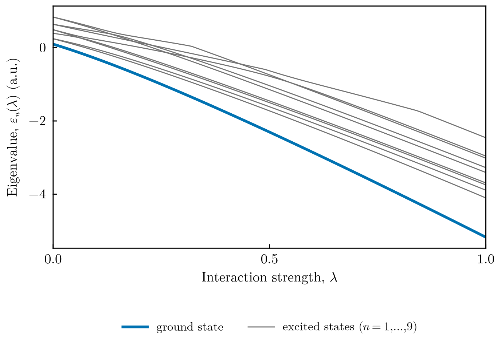
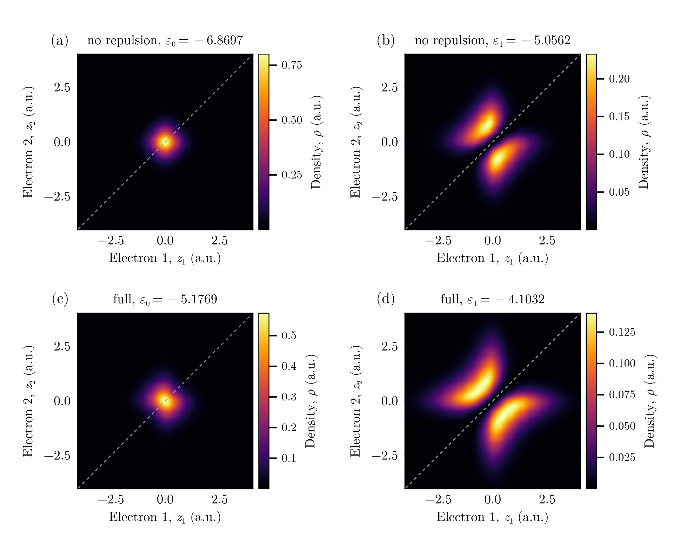

# Two electrons: a one-dimensional model of the helium atom

This tutorial uses a two-dimensional mesh for a different purpose: the two
coordinates are the positions $z_1$ and $z_2$ of **two electrons** moving along a
line, bound to a nucleus of charge $Z = 2$ fixed at the origin. Because the full
two-electron wave function $\Psi(z_1, z_2)$ is computed, electron correlation is
included exactly within the model. In atomic units,

```math
\hat H = -\frac{1}{2}\left(\frac{\partial^2}{\partial z_1^2}+\frac{\partial^2}{\partial z_2^2}\right)
+ \lambda\left[v(z_1-z_2;\,1) - v(z_1;\,Z) - v(z_2;\,Z)\right].
```

The effective interaction $v$ results from integrating out a strong harmonic
confinement in the two transverse directions. Unlike the bare one-dimensional
Coulomb interaction, it is finite at $z = 0$ and behaves as $1/|z|$ at large
distances. The factor $\lambda$ switches all interactions on, from free electrons
in a box ($\lambda = 0$) to the full model ($\lambda = 1$).

All files are in `src/coulomb_interaction_2d_potential/` of the
[FEMTISE_TUTORIAL](https://github.com/mendzmartin/FEMTISE_TUTORIAL) repository.

## 1. The potential

For two charges with product $Q$, transverse confinement length $l$ and Yukawa
screening length $l_\alpha$,

```math
v(z) = \frac{\pi^{3/2}Q}{2l}\,\exp\!\left(\xi^2+\beta^2\right)\operatorname{erfc}(\xi+\beta),
\qquad \xi = \frac{|z|}{l},\quad \beta = \frac{l}{2l_\alpha}.
```

`adhoc_potential_function.jl` evaluates it without overflow, as
$a\,e^{-2\xi\beta}\,h(\xi+\beta)$ with $h(u) = e^{u^2}\operatorname{erfc}(u)$ and
the asymptotic form $h(u)\simeq 1/(\sqrt{\pi}\,u)$ for large $u$. It defines two
potentials with parameters $(l, l_\alpha, z_{\rm nucleus}, Z, \lambda)$:

```julia
# full model: e–e repulsion and attraction of both electrons to the nucleus
function effective_Yukawa_potential_2e(x, params::Tuple)
    confinement_length, Yukawa_length, nuclei_coord, atomic_number, switch_factor = params
    return switch_factor * (
        reduced_confinement_function(x[1], x[2], confinement_length, Yukawa_length, 1.0) -
        reduced_confinement_function(x[1], nuclei_coord, confinement_length, Yukawa_length, atomic_number) -
        reduced_confinement_function(nuclei_coord, x[2], confinement_length, Yukawa_length, atomic_number))
end
# effective_Yukawa_potential_2e_without_repulsion: the same without the first term
```

## 2. The input files

Three calculations share the mesh, the square $(-5, 5)^2$ divided into
$100\times100$ cells, and the parameters $l = 1$, $l_\alpha = 100$ (practically
unscreened), $z_{\rm nucleus} = 0$, $Z = 2$, $\lambda = 1$. The shift
`sigma = -10` is below all levels, so the 50 lowest eigenpairs are returned.

| File | Potential | Purpose |
|---|---|---|
| `input_01.dat` | `effective_Yukawa_potential_2e_without_repulsion` | reference without correlation |
| `input_02.dat` | `effective_Yukawa_potential_2e` | full model at $\lambda = 1$ |
| `input_03.dat` | `effective_Yukawa_potential_2e`, `analysis_param = 5 -0.01 1.0 0.01` | eigenvalues for $\lambda = 0, 0.01, \dots, 1$ |

`input_03.dat`, for example:

```text
full_path_name              = ./output/switch_sweep
dom_type                    = s
nev                         = 50
dimension                   = 2D
sigma                       = -10.0
adhoc_file_name             = ./adhoc_potential_function
potential_function_name     = effective_Yukawa_potential_2e
params_potential_types      = f f f f f
params_potential            = 1.0 100.0 0.0 2 1.0
analysis_param              = 5 -0.01 1.0 0.01
output_format_type          = jld2 eigen
## ONLY FOR 1D EIGENPROBLEMS
L                           =
Δx                          =
## ONLY FOR 2D EIGENPROBLEMS
Lx                          = 10
Ly                          = 10
nx                          = 100
ny                          = 100
different_masses            = false
reduced_density             = false
```

`analysis_param = 5 -0.01 1.0 0.01` sweeps the fifth parameter ($\lambda$). The
driver computes the values $\lambda_i + k\,\Delta\lambda$ for $k\ge1$, so starting at
$-0.01$ makes the first computed value exactly $\lambda = 0$. The mesh is built
once and reused for all 101 values.

## 3. Running the tutorial

```bash
julia --project=. setup.jl        # once
julia --project=. src/coulomb_interaction_2d_potential/run_tutorial.jl
```

The parameter sweep (101 eigenvalue problems with about $4\times10^4$ unknowns each)
takes several minutes. Its results are reused on later runs.

```julia
_, no_repulsion = simulate("input_01")
_, full = simulate("input_02")
_, sweep = simulate("input_03")

λ = real.(sweep.λvector)
levels = sort(real.(sweep.ϵ_matrix), dims = 1)     # ascending order at every λ
save_figure(plot_parameter_sweep(λ, levels; states = 1:10,
                                 parameter_name = "Interaction strength"),
            "figures", "helium_model_sweep")
```

## 4. Results



**Switching on the interactions.** The ten lowest eigenvalues as functions of
$\lambda$. At $\lambda = 0$ the electrons are free in the box, and the levels are
small and positive. As the attraction to the nucleus grows, every level decreases,
and the ground state separates from the rest. At $\lambda = 1$ it reaches
$\varepsilon_0 = -5.1769$. Because the levels are sorted at every $\lambda$,
crossings between levels of different symmetry appear as corners in the curves.



**Correlation.** Two-electron densities $|\Psi(z_1,z_2)|^2$ of the two lowest states,
(a, b) without and (c, d) with the electron–electron repulsion. The dashed line is
$z_1 = z_2$ (both electrons at the same position).
- **Without repulsion**, the ground state (a) is a product of one-electron orbitals.
  Its energy, $-6.8697$, is twice the one-electron energy.
- **The repulsion** (c) raises the ground-state energy by $1.69$ to $-5.1769$ and
  deforms the density away from the diagonal. The electrons tend to be on opposite
  sides of the nucleus.
- **The first excited states** (b, d) vanish on the diagonal: they are antisymmetric
  under the exchange $z_1\leftrightarrow z_2$, i.e. spin triplets, while the ground
  state is symmetric (spin singlet).

## 5. Going further

- **Exchange symmetry.** The Dirichlet problem on the square does not impose any
  exchange symmetry, so singlet and triplet states appear in the same calculation.
  Classify them by comparing $\Psi(z_1,z_2)$ with $\Psi(z_2,z_1)$.
- **Correlation measures.** With `reduced_density = true` the driver computes the
  one-electron densities, from which the Shannon entropies and the mutual
  information between the electrons follow; see the
  [post-processing guide](../manual/postprocessing.md).
- **Other systems.** Changing $Z$, adding a second nucleus, or giving the two
  coordinates different masses (`different_masses`) turns the same files into
  models of ions, molecules or electron–nucleus systems.
