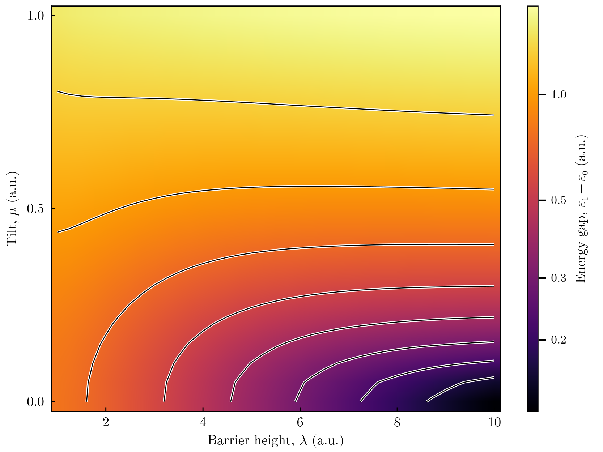
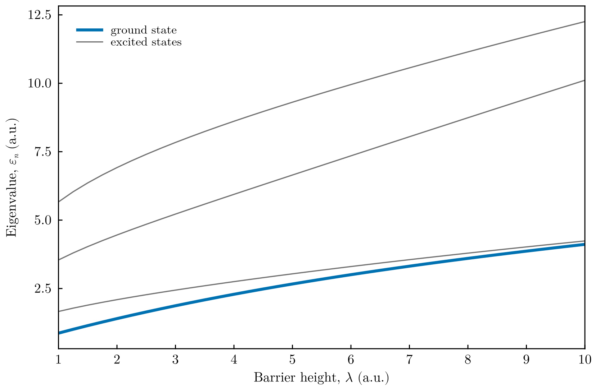

# Eigenvalues over two parameters: the tilted double well

This tutorial computes the eigenvalues as functions of **two parameters of the
potential** and plots them as a two-dimensional map, using the two-parameter
sweeps and the plotting functions introduced in FEMTISE v0.2.0. The system is a
particle (mass 1, atomic units) in the tilted double well

```math
\hat H = -\frac{1}{2}\frac{d^2}{dx^2} + \lambda\,(x^2-1)^2 + \mu\,x ,
```

where $\lambda$ is the height of the barrier between the minima at $x = \pm1$ and
$\mu$ the tilt. In the symmetric well ($\mu = 0$) the two lowest states are the
symmetric and antisymmetric combinations of the states localized in each well;
their **tunnelling splitting** $\varepsilon_1-\varepsilon_0$ decreases
exponentially as the barrier grows. A tilt localizes the states in one well, and
the gap approaches the energy difference between the wells, $\approx 2\mu$.

All files are in `src/double_well_parameter_map/` of the
[FEMTISE_TUTORIAL](https://github.com/mendzmartin/FEMTISE_TUTORIAL) repository.

## 1. The potential

`adhoc_potential_function.jl`:

```julia
function double_well(x, params::Tuple)
    λ, μ = params
    return λ * (x[1]^2 - 1)^2 + μ * x[1]
end
```

## 2. The input file

The first parameter is swept with `analysis_param` and the second one with the
optional setting `analysis_param_2`. Both have the form
`index initial_value final_value step`:

```text
full_path_name              = ./output/double_well_map
dom_type                    = s
nev                         = 4
dimension                   = 1D
sigma                       = -2.0
adhoc_file_name             = ./adhoc_potential_function
potential_function_name     = double_well
params_potential_types      = f f
params_potential            = 1.0 0.0
analysis_param              = 1 0.75 10.0 0.25
output_format_type          = jld2 eigen
## ONLY FOR 1D EIGENPROBLEMS
L                           = 8.0
Δx                          = 0.02
## ONLY FOR 2D EIGENPROBLEMS
Lx                          =
Ly                          =
nx                          =
ny                          =
different_masses            =
reduced_density             =
## OPTIONAL SETTINGS (FEMTISE v0.2.0)
analysis_param_2            = 2 -0.05 1.0 0.05
quadrature_degree           = 8
```

The driver evaluates $\lambda_i + k\,\Delta\lambda$ for $k = 1, 2, \dots$, so the
values above give $\lambda = 1.0, 1.25, \dots, 10.0$ (37 values) and
$\mu = 0.0, 0.05, \dots, 1.0$ (21 values): 777 eigenvalue problems, solved on the
same mesh and finite element spaces. `quadrature_degree = 8` integrates the
quartic potential exactly, so the eigenvalues are upper bounds.

The same sweep with the low-level interface:

```julia
V(x, λ, μ) = λ * (x[1]^2 - 1)^2 + μ * x[1]
model = CartesianDiscreteModel((-4.0, 4.0), (400,))
E = sweep_eigenvalues(model, V, 1.0:0.25:10.0, 0.0:0.05:1.0; nev = 4, sigma = -2.0,
                      quadrature_degree = 8)              # E[n, i, j]
```

## 3. Running the tutorial

```bash
julia --project=. src/double_well_parameter_map/run_tutorial.jl
```

The results are reloaded with `collect_result_data`, which returns an
`AnalysisParams2D` with the fields `ϵ_tensor` (`ϵ_tensor[n, i, j]` is the $n$-th
eigenvalue at $\lambda_i$, $\mu_j$), `λvector` and `μvector`. The figures are drawn
by the plotting functions of FEMTISE, available when a Makie backend is loaded:

```julia
using CairoMakie
fig = plot_energy_map(λ, μ, E; gap = (1, 2), colorscale = log10)   # ε₁ − ε₀
fig = plot_energy_curves(λ, E[:, :, 1])                             # cut at μ = 0
```

## 4. Results



Gap between the two lowest levels over the barrier height $\lambda$ and the tilt
$\mu$, on a logarithmic colour scale with level lines equally spaced in
$\log_{10}(\varepsilon_1-\varepsilon_0)$. At $\mu = 0$ the gap is the tunnelling
splitting, which drops from 0.79 hartree at $\lambda = 1$ to 0.13 hartree at
$\lambda = 10$ (dark corner). For large barriers a small tilt is enough to destroy
the tunnelling doublet: the level lines turn horizontal and the gap is set by the
energy difference of the two wells.



The four lowest eigenvalues of the symmetric well ($\mu = 0$) as functions of the
barrier height. As $\lambda$ grows, the levels pair up into tunnelling doublets:
the ground state (thick line) and the first excited state approach each other.

## 5. Things to try

- Plot a single eigenvalue instead of a gap: `plot_energy_map(λ, μ, E; level = 1)`.
- Plot the gap between the second doublet and the ground state, `gap = (1, 3)`, and
  compare with the vibrational frequency of each well, $\approx\sqrt{8\lambda}$.
- Extend the barrier range and observe the exponential decrease of the splitting on
  the logarithmic colour scale.
