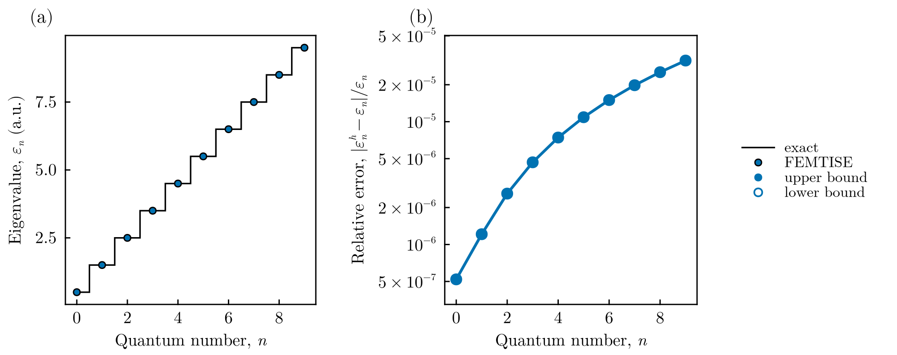
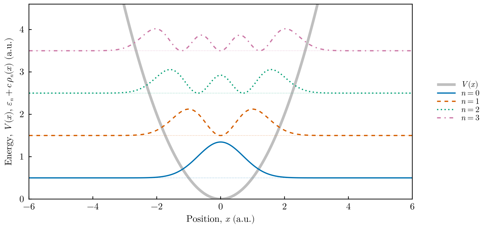

# One-dimensional harmonic oscillator

This tutorial solves the harmonic oscillator with the input-file driver of
`FEMTISE.jl`, compares the result with the exact spectrum and plots the
eigenfunctions. In atomic units ($\hbar = m_e = 1$) the Hamiltonian is

```math
\hat H = -\frac{1}{2}\frac{d^2}{dx^2} + \frac{1}{2}\,\omega^2 (x-x_0)^2,
\qquad \varepsilon_n = \omega\left(n+\tfrac{1}{2}\right),\quad n = 0, 1, 2, \dots
```

All files are in `src/isotropic_1d_harmonic_oscillator_potential/` of the
[FEMTISE_TUTORIAL](https://github.com/mendzmartin/FEMTISE_TUTORIAL) repository.

## 1. The potential

`adhoc_potential_function.jl` defines the potential as a function of the mesh point
`x` and a tuple of parameters:

```julia
function qho_1d(x, params::Tuple)
    ω, x₀ = params
    return 0.5 * ω^2 * (x[1] - x₀)^2
end
```

## 2. The input file

`input.dat` asks for the 10 lowest levels (`sigma = 0` lies below the ground state)
with $\omega = 1$ and $x_0 = 0$, on the domain $(-50, 50)$ with elements of
size $\Delta x = 0.1$:

```text
full_path_name              = ./output/qho1d
dom_type                    = s
nev                         = 10
dimension                   = 1D
sigma                       = 0.0
adhoc_file_name             = ./adhoc_potential_function
potential_function_name     = qho_1d
params_potential_types      = f f
params_potential            = 1.0 0.0
analysis_param              = false
output_format_type          = jld2 all
## ONLY FOR 1D EIGENPROBLEMS
L                           = 100
Δx                          = 0.1
## ONLY FOR 2D EIGENPROBLEMS
Lx                          =
Ly                          =
nx                          =
ny                          =
different_masses            =
reduced_density             =
```

The meaning of every field is explained in the
[input file reference](../manual/input_file.md).

## 3. Running the tutorial

From the root of the repository (the first command is needed only once):

```bash
julia --project=. setup.jl
julia --project=. src/isotropic_1d_harmonic_oscillator_potential/run_tutorial.jl
```

`run_tutorial.jl` performs three steps:

```julia
# 1. solve (skipped if ./output already contains the results; use --rerun to force)
id, results = simulate("input")
ε, order = sorted_spectrum(results)          # eigenvalues in ascending order
ϕ = results.ϕ[order]                         # eigenfunctions (finite element functions)

# 2. compare with the exact levels
exact = [ω * (n + 0.5) for n in 0:length(ε)-1]

# 3. figures (PDF + PNG in ./figures)
save_figure(plot_spectrum(ε; exact = exact), "figures", "qho1d_spectrum")
x = collect(range(-6.0, 6.0, length = 1201))
densities = [abs2.(sample_on_grid(ψ, x)) for ψ in ϕ]
fig = plot_densities_1d(x, densities, ε; potential = 0.5 .* x .^ 2, states = 1:4, scale = 1.5)
save_figure(fig, "figures", "qho1d_densities")
```

`simulate`, `sorted_spectrum` and `sample_on_grid` are defined in
`tools/TutorialSimulation.jl`. The plotting functions are in
`tools/TutorialFigures.jl`.

## 4. Results



**Spectrum.** (a) The ten computed eigenvalues (markers) lie on the exact levels
$n+1/2$ (steps). (b) Relative error. All eigenvalues are upper bounds (filled
markers). The error grows with $n$ because higher states oscillate faster and are
resolved by fewer elements per wavelength. It stays below $3.2\times10^{-5}$.



**Eigenfunctions.** Probability densities $\rho_n(x) = |\psi_n(x)|^2$ of the four
lowest states, drawn at the height of their energies over the potential (thick gray
line). The $n$-th state has $n$ nodes and extends to the classical turning points
$x=\pm\sqrt{2n+1}$.

## 5. Going further

- **Accuracy.** The driver uses quadratic elements with a quadrature of degree 3.
  Halving `Δx` reduces the error by a factor of about 16 (convergence as $h^4$).
  For certified upper bounds use the low-level interface with an exact quadrature
  (see the [accuracy guide](../manual/accuracy.md)).
- **Other observables.** Because `output_format_type = jld2 all`, `results` contains
  the mesh, the measures and the finite element spaces, e.g.
  `coord_second_moment(results.ϕ, results.USpace, results.Ω, results.dΩ, 1)` returns
  $\langle x^2\rangle = n + 1/2$ for each state.
- **Parameter sweep.** Set `analysis_param = 1 0.5 2.0 0.1` and
  `output_format_type = jld2 eigen` (sweeps store only eigenvalues) to compute the
  levels as a function of $\omega$.
