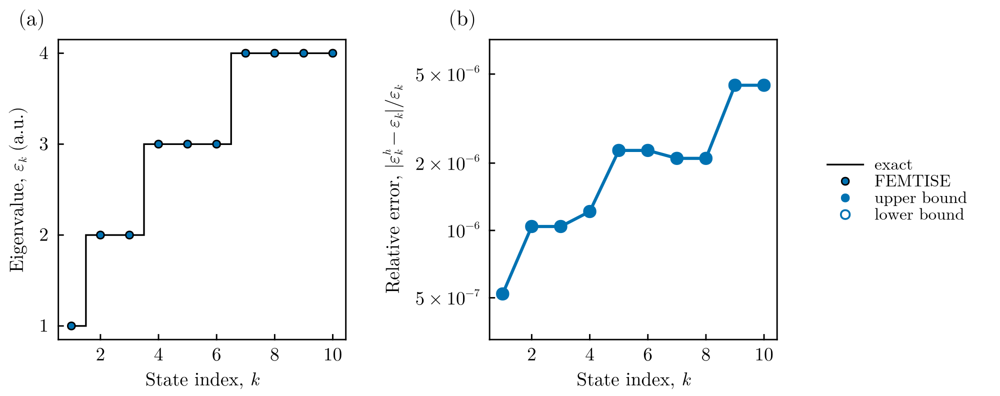
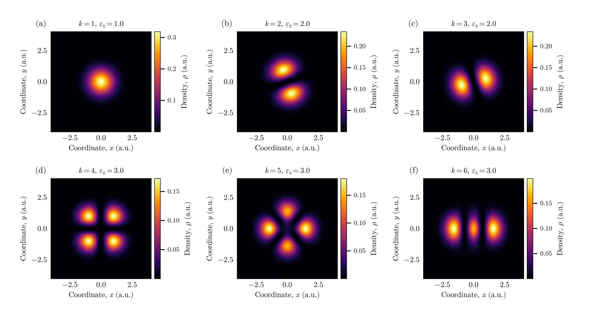

# Two-dimensional harmonic oscillator

This tutorial solves a two-dimensional problem with the input-file driver: the
isotropic harmonic oscillator, whose levels are degenerate. In atomic units,

```math
\hat H = -\frac{1}{2}\left(\frac{\partial^2}{\partial x^2}+\frac{\partial^2}{\partial y^2}\right)
+ \frac{1}{2}\,\omega^2\left[(x-x_0)^2+(y-y_0)^2\right],
\qquad \varepsilon = \omega\,(n+1),\quad n = n_x+n_y ,
```

and the level $n$ is $(n+1)$-fold degenerate. The same file describes two
one-dimensional particles of equal mass in a common harmonic trap.

All files are in `src/isotropic_2d_harmonic_oscillator_potential/` of the
[FEMTISE_TUTORIAL](https://github.com/mendzmartin/FEMTISE_TUTORIAL) repository.

## 1. The potential

```julia
function qho_2d(x, params::Tuple)
    ω, x₀, y₀ = params
    return 0.5 * ω^2 * ((x[1] - x₀)^2 + (x[2] - y₀)^2)
end
```

## 2. The input file

The 10 lowest levels with $\omega = 1$ on the square $(-5, 5)^2$, divided into
$100\times100$ cells of quadratic elements:

```text
full_path_name              = ./output/qho2d
dom_type                    = s
nev                         = 10
dimension                   = 2D
sigma                       = 0.0
adhoc_file_name             = adhoc_potential_function
potential_function_name     = qho_2d
params_potential_types      = f f f
params_potential            = 1.0 0.0 0.0
analysis_param              = false
output_format_type          = jld2 eigen
## ONLY FOR 1D EIGENPROBLEMS
L                           =
Δx                          =
## ONLY FOR 2D EIGENPROBLEMS
Lx                          = 10
Ly                          = 10
nx                          = 100
ny                          = 100
different_masses            = false
reduced_density             = false
```

## 3. Running the tutorial

```bash
julia --project=. setup.jl        # once
julia --project=. src/isotropic_2d_harmonic_oscillator_potential/run_tutorial.jl
```

The script solves the problem (unless results already exist in `./output`), compares
the eigenvalues with the exact degenerate spectrum and samples the densities on a
regular grid:

```julia
id, results = simulate("input")
ε, order = sorted_spectrum(results)
ϕ = results.ϕ[order]
exact = sort([ω * (nx + ny + 1) for nx in 0:10 for ny in 0:10])[1:length(ε)]
save_figure(plot_spectrum(ε; exact = exact, index_offset = 1,
                          index_name = "State index", index_symbol = "k"),
            "figures", "qho2d_spectrum")

grid = collect(range(-4.0, 4.0, length = 161))
densities = [abs2.(sample_on_grid(ϕ[k], grid, grid)) for k in 1:6]
save_figure(plot_density_maps(grid, grid, densities, titles; columns = 3),
            "figures", "qho2d_densities")
```

## 4. Results



**Spectrum.** (a) The computed eigenvalues reproduce the levels $1, 2, 3, 4$ with
degeneracies $1, 2, 3, 4$. (b) Relative error, below $5\times10^{-6}$ for all ten
states. All eigenvalues are upper bounds.



**Eigenfunctions.** Densities of the six lowest states. Within a degenerate level any
linear combination of eigenvectors is also an eigenvector, so the orientation of the
nodal lines of states (b)–(c) and (d)–(f) is arbitrary: the solver returns *some*
basis of each degenerate subspace. Quantities that are invariant within the
subspace, such as the total density of a level, do not depend on this choice.

## 5. Going further

- **Different masses.** Setting `different_masses = 0.25` gives the second coordinate
  a mass four times larger ($p_2 = 0.25\,p_1$). The levels become
  $(n_x+\tfrac12)\,\omega + (n_y+\tfrac12)\,\omega/2$ and the degeneracies change.
- **Reduced densities.** With `reduced_density = true` the driver also computes
  $\rho^{(1)}(x)=\int\rho\,dy$ and $\rho^{(2)}(y)=\int\rho\,dx$.
- **Orthogonal basis of a degenerate level.** The vectors returned for a degenerate
  level are linearly independent but not necessarily orthogonal; see the
  [post-processing guide](../manual/postprocessing.md).
