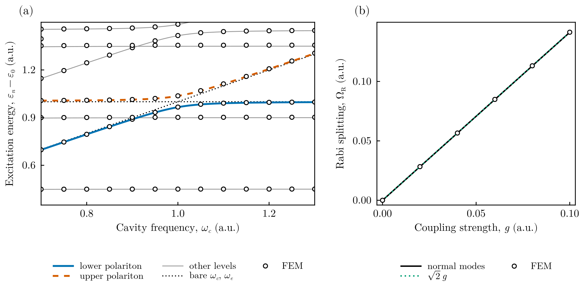

# Nucleus + electron + cavity photon: the Pauli–Fierz Hamiltonian

This tutorial solves a problem with **three one-dimensional degrees of freedom of
different nature**: a nuclear coordinate, an electronic coordinate and the
displacement coordinate of a cavity photon mode. It uses the three-dimensional
solver of FEMTISE v0.2.0 with one mass per coordinate and the helper
`pauli_fierz_potential`.

## 1. The Hamiltonian

In the length gauge and the dipole approximation, a molecule coupled to one cavity
mode of frequency $\omega_c$ is described by the Pauli–Fierz Hamiltonian
(atomic units)

```math
\hat H = -\frac{1}{2M}\frac{\partial^2}{\partial R^2}
-\frac{1}{2}\frac{\partial^2}{\partial z^2}
-\frac{1}{2}\frac{\partial^2}{\partial q^2}
+ V_m(R,z) + \frac{1}{2}\omega_c^2 q^2 + g\sqrt{2\omega_c}\,q\,d(R,z)
+ \frac{g^2}{\omega_c}\,d(R,z)^2 ,
```

where $R$ is the nuclear coordinate (mass $M$), $z$ the electronic coordinate
(mass 1), $q$ the photon displacement coordinate, $d$ the dipole moment and $g$ the
light–matter coupling strength. The last term, the dipole self-energy, keeps the
Hamiltonian bounded from below. The photon coordinate enters the kinetic energy
with unit mass, so the masses of the coordinates $(R, z, q)$ are $(M, 1, 1)$.

To check the results level by level we use a quadratic model,

```math
V_m(R,z) = \tfrac12 k_R R^2 + \tfrac12 k_z z^2,\qquad d = R - z,
```

with $M = 4$, $k_R = 0.81$ (nuclear frequency $\Omega_\mathrm{nuc} = \sqrt{k_R/M} = 0.45$)
and $k_z = 1$ (electronic excitation $\omega_e = 1$). Its levels are
$\sum_k \Omega_k(n_k+\frac12)$, with $\Omega_k^2$ the eigenvalues of the
mass-weighted Hessian of $V$ (normal modes).

When $\omega_c$ crosses $\omega_e$ the electronic and photonic excitations
hybridize into a **lower and an upper polariton**, separated at resonance by the
Rabi splitting. To lowest order in $g$,
$\Omega_\mathrm{R} \approx 2g\sqrt{2\omega_c}\,|q_{01}|\,|d_{01}| = \sqrt2\,g$ for this
model ($q_{01} = 1/\sqrt{2\omega_c}$, $d_{01} = 1/\sqrt{2\omega_e}$).

All files are in `src/pauli_fierz_cavity/` of the
[FEMTISE_TUTORIAL](https://github.com/mendzmartin/FEMTISE_TUTORIAL) repository.

## 2. The calculation

`pauli_fierz_potential` builds $V(R, z, q)$ from the matter potential and the
dipole, both functions of the mesh point; the photon coordinate is always the
**last** coordinate:

```julia
using FEMTISE, Gridap

M, k_R, k_z = 4.0, 0.81, 1.0
matter(r) = 0.5k_R * r[1]^2 + 0.5k_z * r[2]^2      # r = (R, z, q)
dipole(r) = r[1] - r[2]
cavity(ω_c, g) = pauli_fierz_potential(matter, dipole; frequency = ω_c, coupling = g)

model = CartesianDiscreteModel((-3.5, 3.5, -5.0, 5.0, -5.0, 5.0), (14, 18, 18))
sol = solve_tise(model, cavity(1.0, 0.05); masses = (M, 1.0, 1.0), nev = 10)
```

The tutorial sweeps the cavity frequency at fixed coupling and the coupling at
resonance with `sweep_eigenvalues`, which builds the mesh and the finite element
spaces once:

```julia
E_frequency = sweep_eigenvalues(model, (x, ω_c) -> cavity(ω_c, 0.05)(x), 0.70:0.05:1.30;
                                masses = (M, 1.0, 1.0), nev = 10)
E_coupling = sweep_eigenvalues(model, (x, g) -> cavity(1.0, g)(x), 0.0:0.02:0.10;
                               masses = (M, 1.0, 1.0), nev = 10)
```

Run it with

```bash
julia --project=. src/pauli_fierz_cavity/run_tutorial.jl
```

The 19 three-dimensional problems (about 33 000 unknowns each, P2 elements) take
roughly 10 minutes and a few GB of memory; the results are stored in
`output/pauli_fierz_sweeps.jld2` and reused by later runs (`--rerun` recomputes
them). The script prints

```text
largest error of the excitation energies below 1.5 hartree: 0.0063 hartree
Rabi splitting, g = [0.0, 0.02, 0.04, 0.06, 0.08, 0.1]
  FEM   [0.0, 0.02830, 0.05660, 0.08490, 0.11318, 0.14144]
  exact [0.0, 0.02828, 0.05656, 0.08484, 0.11310, 0.14134]
```

The largest errors occur for the highest levels of the window (multiply excited
nuclear states). The polariton levels are accurate to about $10^{-3}$ hartree and
the Rabi splitting to better than $0.1\%$; refining the mesh reduces all errors.

## 3. Results



**(a)** Excitation energies as functions of the cavity frequency ($g = 0.05$).
Circles: finite element results; lines: exact normal-mode levels. Far from
resonance the levels follow the bare cavity frequency $\omega_c$ and the bare
electronic excitation $\omega_e$ (dotted). Near $\omega_c = \omega_e$ they avoid
each other and form the lower (solid) and upper (dashed) polaritons. The flat gray
lines are nuclear excitations ($\Omega_\mathrm{nuc}$, $2\Omega_\mathrm{nuc}$,
$3\Omega_\mathrm{nuc}$) and the rising ones combination levels (one nuclear quantum
plus one polariton). The nuclear overtone $2\Omega_\mathrm{nuc} = 0.9$ crosses the
lower polariton without repelling it: in this quadratic model the normal modes are
independent, so levels belonging to different modes cross exactly. With an
anharmonic potential these crossings become avoided crossings.

**(b)** Rabi splitting at resonance ($\omega_c = \omega_e$) as a function of the
coupling: finite elements (circles), exact normal modes (solid) and the
lowest-order estimate $\sqrt2\,g$ (dotted). In this range the three agree within
the line width: the system is in the linear (strong-coupling, not ultrastrong)
regime.

## 4. Things to try

- Replace the harmonic electronic potential by an anharmonic one (e.g. a soft
  Coulomb potential): the normal modes are then no longer exact, but the FEM
  levels remain upper bounds.
- Switch off the dipole self-energy, `dipole_self_energy = false`, and increase $g$:
  for large enough coupling the potential is no longer bounded from below.
- Make the nucleus heavier ($M = 1836$) to approach the Born–Oppenheimer regime and
  observe the closely spaced nuclear levels dressing each polariton.
