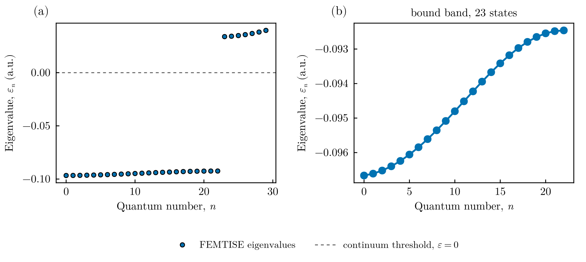
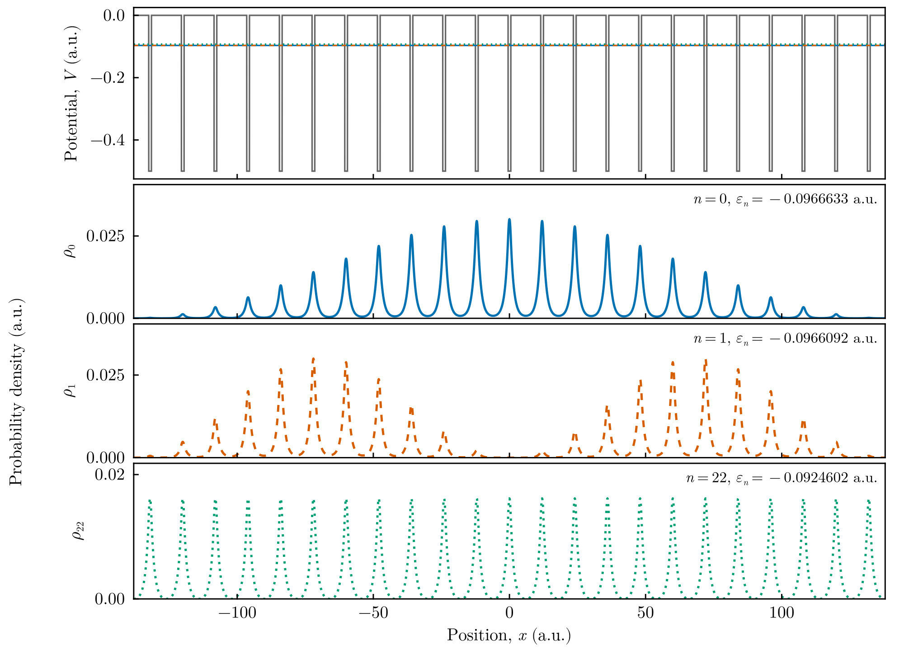

# Finite Kronig–Penney chain

This tutorial computes the bound states of an electron in a finite chain of square
wells, a minimal model of a one-dimensional crystal or of a semiconductor
superlattice. In atomic units,

```math
\hat H = -\frac{1}{2}\frac{d^2}{dx^2} + V(x),\qquad
V(x) = \begin{cases} V_0 < 0 & \text{inside one of the } N \text{ wells (width } b\text{, centres separated by } a),\\
0 & \text{otherwise.}\end{cases}
```

For an isolated well the single bound level lies at $\varepsilon\approx-0.095$. When
$N$ such wells are coupled by tunnelling through the barriers, this level splits
into $N$ levels that form a **band**. The potential is discontinuous, which the
finite element method handles exactly as long as the mesh nodes coincide with the
well edges.

All files are in `src/symmetric_finite_1d_kronig_penney_potential/` of the
[FEMTISE_TUTORIAL](https://github.com/mendzmartin/FEMTISE_TUTORIAL) repository.

## 1. The potential

`adhoc_potential_function.jl` builds the chain from the Heaviside function
(`symetric_kronig_penney`) and provides it in the form required by the driver:

```julia
function kronig_penney_potential(x, params::Tuple)
    num_ions, a, b, V₀ = params
    return symetric_kronig_penney(x[1], num_ions, a, b, V₀)
end
```

## 2. The input file

$N = 23$ wells of width $b = 1$ and depth $V_0 = -0.5$, with centres separated by
$a = 12$, in the domain $(-138, 138)$. The element size $\Delta x = 0.01$ places a
node exactly at every well edge. The shift `sigma` $=V_0$ is below all levels, so
the 30 lowest eigenpairs are returned. The parameter types are `i f f f` because the
number of wells is an integer:

```text
full_path_name              = ./output/kronig_penney
dom_type                    = s
nev                         = 30
dimension                   = 1D
sigma                       = -0.5
adhoc_file_name             = ./adhoc_potential_function
potential_function_name     = kronig_penney_potential
params_potential_types      = i f f f
params_potential            = 23 12.0 1.0 -0.5
analysis_param              = false
output_format_type          = jld2 eigen
## ONLY FOR 1D EIGENPROBLEMS
L                           = 276.0
Δx                          = 0.01
## ONLY FOR 2D EIGENPROBLEMS
Lx                          =
Ly                          =
nx                          =
ny                          =
different_masses            =
reduced_density             =
```

## 3. Running the tutorial

```bash
julia --project=. setup.jl        # once
julia --project=. src/symmetric_finite_1d_kronig_penney_potential/run_tutorial.jl
```

The script solves the problem, counts the bound states ($\varepsilon < 0$) and draws
the spectrum and the densities of the bottom, second and top states of the band:

```julia
id, results = simulate("input")
ε, order = sorted_spectrum(results)
ϕ = results.ϕ[order]
bound = count(<(0.0), ε)                         # 23

states = (1, 2, bound)
densities = [n in states ? abs2.(sample_on_grid(ϕ[n], x)) : Float64[] for n in eachindex(ϕ)]
fig = plot_densities_stacked(x, densities, ε; potential = potential, states = states)
save_figure(fig, "figures", "kronig_penney_densities")
```

## 4. Results



**Spectrum.** (a) The 30 computed levels. Exactly 23 of them, one per well, are bound
($\varepsilon<0$). The levels above the continuum threshold $\varepsilon = 0$ are
states of the finite box. (b) Zoom on the bound band. The levels span
$-0.0967 \le \varepsilon \le -0.0925$. Their spacing is smallest at the band edges,
as in the cosine dispersion $\varepsilon(q)\simeq\varepsilon_0-2t\cos(qa)$ of a
tight-binding chain.



**Eigenfunctions.** Top: the potential with the energies of the three states shown
below (horizontal lines). The densities are concentrated in the wells and modulated
by a slowly varying envelope. The bottom of the band ($n=0$) has a nodeless
envelope, like the ground state of a particle in a box of length $Na$. The next
state ($n=1$) has one node of the envelope. The top of the band ($n=22$)
distributes its weight almost uniformly over all wells.

## 5. Going further

- **Band formation.** Repeat the calculation with $N = 1, 3, 5, \dots$ wells: the
  single level of one well splits into $N$ levels, which fill a band of fixed width
  as $N$ grows. The width of the band decreases exponentially with the barrier
  width $a-b$.
- **Mesh alignment.** If the well edges do not coincide with mesh nodes, the
  convergence of the eigenvalues drops from $h^4$ to $h$; see the
  [accuracy guide](../manual/accuracy.md).
