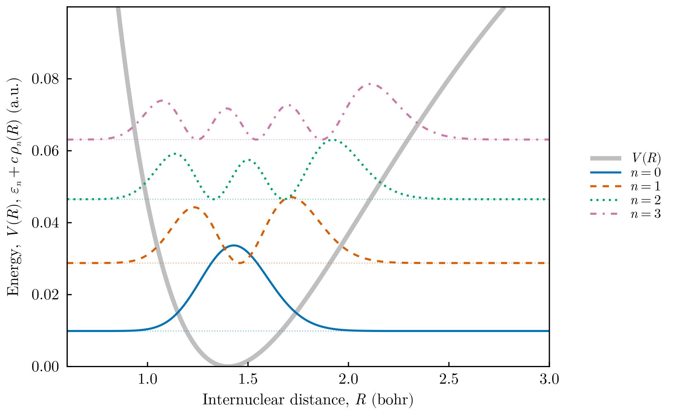
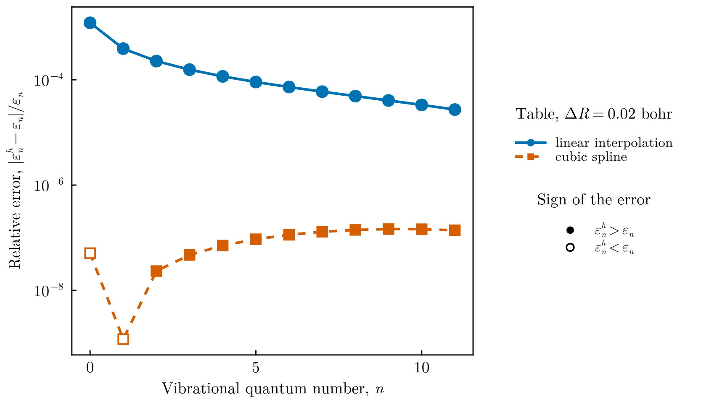

# Vibrational levels from a tabulated potential

This tutorial computes the vibrational levels of a diatomic molecule from a
potential energy curve given as a **table of values**, as produced by an
electronic-structure calculation or by experiment. It uses two features
introduced in FEMTISE v0.2.0: potentials read from data files and particles of
arbitrary mass. In atomic units the Hamiltonian is

```math
\hat H = -\frac{1}{2\mu}\frac{d^2}{dR^2} + V(R),
```

where $R$ is the internuclear distance and $\mu = 918.08\,m_e$ the reduced mass of
the two protons of H₂. The table is generated from the Morse potential

```math
V(R) = D\left[1-e^{-a(R-R_e)}\right]^2,\qquad
\varepsilon_n = \omega\left(n+\tfrac12\right)-\frac{\omega^2}{4D}\left(n+\tfrac12\right)^2,
\quad \omega = a\sqrt{2D/\mu},
```

with $D = 0.1745$ hartree, $a = 1.0282$ bohr⁻¹ and $R_e = 1.4011$ bohr, so that the
levels obtained from the table can be compared with the exact ones.

All files are in `src/tabulated_morse_vibrations/` of the
[FEMTISE_TUTORIAL](https://github.com/mendzmartin/FEMTISE_TUTORIAL) repository.

## 1. The data file

`pec.dat` (written by `make_potential_table.jl`) has two columns, $R$ in bohr and
$V(R)$ in hartree, on a grid with spacing $\Delta R = 0.02$ bohr. Lines starting
with `#` are comments:

```text
# Morse potential energy curve of H2 (atomic units)
# R (bohr)    V(R) (hartree)
0.0    1.8129686525098436
0.02    1.717559043501458
...
```

## 2. The input files

The potential function fields are left empty and the table, the mass and the
interpolation are given in the optional settings at the end of the input file.
`input_cubic.dat`:

```text
full_path_name              = ./output/morse_cubic
dom_type                    = ns
nev                         = 12
dimension                   = 1D
sigma                       = 0.0
adhoc_file_name             =
potential_function_name     =
params_potential_types      =
params_potential            =
analysis_param              = false
output_format_type          = jld2 eigen
## ONLY FOR 1D EIGENPROBLEMS
L                           = 8.0
Δx                          = 0.01
## ONLY FOR 2D EIGENPROBLEMS
Lx                          =
Ly                          =
nx                          =
ny                          =
different_masses            =
reduced_density             =
## OPTIONAL SETTINGS (FEMTISE v0.2.0)
masses                      = 918.08
potential_data_file         = ./pec.dat
interpolation               = cubic
quadrature_degree           = 6
```

`dom_type = ns` places the domain on $(0, L)$, which the table covers. The file
`input_linear.dat` is identical except for `interpolation = linear`. Input files
with optional settings must use `output_format_type = jld2 eigen`. The same
calculation with the low-level interface reads

```julia
V = tabulated_potential("pec.dat"; interpolation = :cubic)
model = CartesianDiscreteModel((0.0, 8.0), (800,))
sol = solve_tise(model, V; masses = 918.08, nev = 12, quadrature_degree = 6)
```

## 3. Running the tutorial

```bash
julia --project=. src/tabulated_morse_vibrations/run_tutorial.jl
```

The script solves both input files, compares the levels with the exact Morse
levels and draws the figures. It prints

```text
ω = 0.0200… hartree; largest relative error: linear 1.2e-3, cubic 1.5e-7
```

## 4. Results



The tabulated potential (thick gray line) with the four lowest vibrational levels and their
probability densities $|\psi_n(R)|^2$, drawn at the height of each level. The
densities become asymmetric as the anharmonicity of the curve grows.



Relative error of the twelve lowest levels. With the same table and the same mesh,
the natural cubic spline is four orders of magnitude more accurate than linear
interpolation: the error of the levels is dominated by the interpolation of the
table, not by the finite elements. Filled markers indicate levels above the exact
value, open markers levels below: the variational upper bound holds for the
interpolated potential, not for the exact curve the table was sampled from.

## 5. Things to try

- Change the spacing of the table in `make_potential_table.jl` and check that the
  error scales as $\Delta R^2$ (linear) and $\Delta R^4$ (cubic spline).
- Replace `pec.dat` by a potential energy curve of your own, for example from an
  *ab initio* calculation. Make sure the table covers the whole domain $(0, L)$, or
  set `extrapolation = :flat` in the low-level interface.
- Use the mass of a different isotopologue (HD: $\mu = 1223.9$, D₂: $\mu = 1835.2$)
  and observe the $1/\sqrt{\mu}$ scaling of the vibrational frequency.
